# Analysis Pipeline — User Guide

This guide covers every module in the Analysis Pipeline app in depth: how to
use it, what it reports, the statistics behind it and why they're
appropriate, and how to read its exported output. For a one-page overview,
see the Quick Guide instead.

## 1. Running the app

**Requirements.** MATLAB (developed against R2023b) with two toolboxes:

- **Curve Fitting Toolbox** — every exponential and Gaussian-mixture fit in
  the app goes through this (`fit`, `fittype`, `confint`).
- **Statistics and Machine Learning Toolbox** — `cdfcalc` (used by every
  eCDF-based module), `fitglme` and `ranksum` (Association/Dissociation
  Conformations and Event Sorting by Mean FRET).

No other toolboxes are required — the heatmap smoothing step deliberately
avoids the Image Processing Toolbox.

**To launch the app:**

1. Open MATLAB.
2. Make sure the folder containing `AnalysisPipelineApp.m` and the
   `+modules`/`+pipeline` package folders is on the MATLAB path. This app's
   modules are MATLAB packages (`modules.*`, `pipeline.*`); MATLAB won't
   find them unless their *parent* folder — not `+modules`/`+pipeline`
   themselves — is on the path. For a single session, set your MATLAB
   **Current Folder** to that folder. **Permanently (recommended)**: add it
   to your saved path once via **Home → Set Path...** (or run `pathtool`,
   or call `addpath('...'); savepath;` in the Command Window) so it's
   available every time you open MATLAB, with no need to navigate there
   first. If this app is installed inside your lab's shared `MatlabScripts`
   directory, make sure `MatlabScripts` has been added to the path this way
   (via **Set Path...**, not just left in a folder you happen to `cd` into)
   — that's what makes the app callable from any Current Folder.
3. In the Command Window, type `AnalysisPipelineApp` and press Enter. This
   calls the class constructor and opens the GUI window — no arguments
   needed.
4. To keep a handle to the running app instance instead (useful for
   scripting, or inspecting `app.Data`/`app.ResultLogs` directly from the
   Command Window while the GUI is open), assign it to a variable instead:
   `app = AnalysisPipelineApp();`

The window opens with every module button visible; all but **Combined
Dataset Overlay** stay disabled until you load a state-assignment file (§2).

## 2. Data and general workflow

### Input file

The app loads a single `.mat` file (conventionally named
`*_assigned_corrected.mat`) containing:

- `ttotal` — a `[frames × (1 + nChPerMol·molecules)]` matrix: column 1 is
  the time axis (seconds), and each molecule occupies `nChPerMol`
  consecutive columns (one per channel) after that.
- `states` — the same shape as `ttotal`, giving each channel's discrete
  state assignment (e.g. ON/OFF) per frame.
- `channelNames` — the name of each of the `nChPerMol` channels, in column
  order.
- `nChPerMol` — number of channels per molecule.

**Older files (backwards compatibility).** Files from before multi-color
support contain only `ttotal` and `states`. If a file has those two
variables and *neither* `channelNames` nor `nChPerMol`, the app treats it
as 2-color data with three channels per molecule — `donor`, `acceptor`,
`fret` — and notes this in the status log. It first checks that `ttotal`
and `states` are the same size and that the number of data columns (all
columns after the time column) is a multiple of 3; if not, it shows an
error instead of guessing. A file with only *one* of `channelNames` /
`nChPerMol` is not treated as old-format and is rejected as missing
required variables. The file dialog therefore lists every `.mat` file, not
only `*_assigned_corrected.mat`; extra variables in a file are ignored.

On load, the app scans every channel for a detectable ON level and extracts
**binding events**: continuous runs of frames where a channel is in its ON
state. Each event records which molecule it belongs to, its start/end
frame, start/end time, and lifetime (duration in seconds). Every analysis
module operates on this event list. **Min event frames** (on the main
window) discards events shorter than a chosen number of frames before any
module sees them — useful for filtering single-frame noise spikes that
aren't real binding events.

### Event filters

Most modules offer an **Events** dropdown with three choices, used the
same way everywhere:

- **All events** — every detected event.
- **First event** — only the first event per molecule.
- **Subsequent events** — every event after the first, per molecule.

This distinction matters statistically: "All events" and "Subsequent
events" can include multiple events from the same molecule, which is the
reason several modules resample by *molecule* rather than by *event* when
computing confidence intervals (see below).

### Fit, Save Fit, and result logs

Every curve-fitting module (exponential or Gaussian-mixture) follows the
same pattern:

- **Fit** runs the point-estimate fit and draws the curve — a quick trial
  you can repeat with different guesses or settings. It logs nothing.
- **Save Fit** re-runs that same fit and *additionally* runs a bootstrap
  (see below) to get a confidence interval on the fitted parameters, then
  appends one row to that module's own result table.
- **Export CSV...** saves that module's own table. Every module's result
  table is completely independent — no module's fits ever mix into another
  module's CSV, so each exported file has a clean, consistent column set.

Because Save Fit always reflects the *most recent* Fit, changing a control
that changes the underlying data (channel, event filter, etc.) disables
Save Fit until you click Fit again — this prevents accidentally logging a
fit for data that's no longer what's on screen.

### Bootstrap confidence intervals: why resample by molecule

Every bootstrap CI in this app is a **molecule-level cluster bootstrap**:
each resample draws *M* molecules with replacement (*M* = number of
distinct molecules in the data being fit) and includes **all** of that
molecule's events/frames, then refits from scratch. The module repeats this
many times (the "Bootstrap N" you set); the CI is the 2.5th/97.5th
percentile of the resulting distribution of fitted parameters.

This is deliberate, not incidental: events (or frames) from the *same*
molecule aren't statistically independent observations — molecule-to-molecule
kinetic heterogeneity is common in single-molecule data, so a molecule that
happens to contribute several events shouldn't get to "vote" several times
as if each vote were independent. Plain event-level resampling would treat
every event as an independent draw and understate the true uncertainty
whenever a molecule contributes more than one event — exactly the case for
the "All events" and "Subsequent events" filters. For "First event" filters
(exactly one event per molecule by construction), molecule-level and
event-level resampling are mathematically identical, so it's always safe to
resample by molecule regardless of which filter is active.

For fits with more than one component (a double exponential, or a
multi-Gaussian mixture), the module matches each bootstrap iteration's
fitted components back to the original point estimate's components (by
whichever labeling minimizes total distance) before pooling them —
otherwise a model
that's symmetric under swapping components ("label switching") could mix
two physically distinct populations into one nonsensical pooled
distribution.

### Fit CI vs. Bootstrap CI

Two different confidence intervals appear throughout this app, and they
answer different questions:

- **Fit CI** comes directly from the curve fit's own asymptotic covariance
  estimate (the same thing MATLAB's `confint()` reports). It's essentially
  free to compute, but relies on standard nonlinear-regression assumptions
  (large enough sample size, a correctly specified model, reasonably
  well-behaved residuals) that may not hold well for a rough or sparse
  dataset.
- **Bootstrap CI** comes from the molecule-level resampling procedure above.
  It's nonparametric (no asymptotic-normality assumption) and correctly
  accounts for molecule-level clustering, but costs more to compute and
  depends on having enough distinct molecules to resample from meaningfully.

Both appear wherever available; in CSV exports each is its own single
column formatted as `[lower, upper]` (see `pipeline.formatCI`), explicitly
labeled `_FitCI` or `_BootstrapCI` — never abbreviated to bare Lower/Upper
columns, so it's always unambiguous which kind of interval a given column
is.

### Exporting plots

Every module's **Export Plot...** button writes a matched `.eps` + `.png` +
`.fig` set with one consistent house style: a fixed-size square or
landscape panel, transparent background (white background for `.fig`,
since a truly transparent `.fig` renders as solid black if you ever open it
directly), gray axis lines, and consistent font/line weights sized for
direct use in a manuscript figure — no further tidying up needed. `.fig`
files exported this way can be re-combined later in **Combined Dataset
Overlay** (see below).

## 3. Binding Lifetime Kinetics

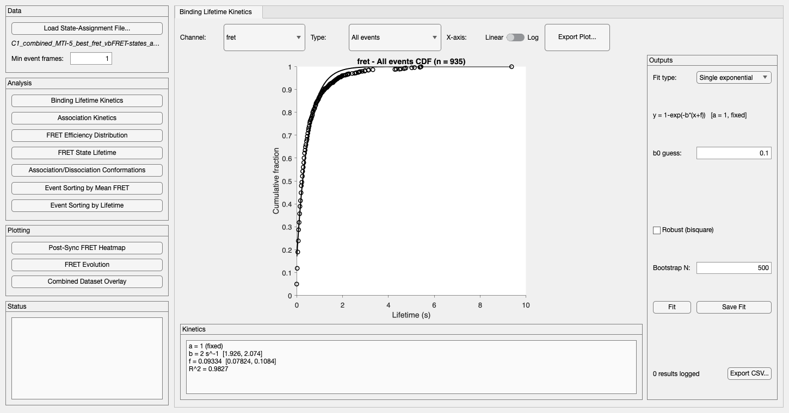

**Purpose.** How fast does a bound complex dissociate? Fits an exponential
decay to the distribution of event lifetimes (how long each binding event
lasted).

**How to use it.** Pick a **Channel** and an **Events** filter. The plot
updates immediately, showing the empirical CDF (eCDF) of that channel's
event lifetimes. Choose **Single exponential** or **Double exponential**
under Fit type, optionally adjust the rate guesses (`b0`, and `d0` for a
double exponential) if the default doesn't converge well, and click **Fit**.
When satisfied, click **Save Fit** to log the result with its bootstrap CI.

**What it reports.** The plot is the eCDF (open circles) with the fitted
curve overlaid (black line). The Kinetics panel below shows the fitted
coefficients, their Fit CIs, and R².

### Why single-molecule dwell times need a distribution, not a single measurement

Single-molecule dwell times are random in two distinct, compounding ways,
and both are why this module fits a whole distribution of lifetimes rather
than simply reporting an average.

**The underlying process is stochastic.** Dissociation isn't a scheduled,
deterministic event — it's a thermally-driven transition, and only a
constant probability per unit time governs when it happens. Two molecules in
*identical* chemical environments, with *identical* true rate constants,
will still dissociate at different, unpredictable times, because the
process itself is random — not because of experimental imprecision. That
randomness is a real physical feature of the system under study, not
noise to correct away; it's exactly what the exponential model below
describes. A direct consequence: a single event's lifetime carries almost
no information about the underlying rate on its own (a fast-dissociating
population can still occasionally produce one long-lived event, and vice
versa) — only the *shape of the distribution* across many events lets you
recover the rate constant reliably, which is why this module always needs
an eCDF built from many events, never a single measurement.

**The observed sample is itself a random draw.** Separately, the specific
set of binding events one experiment happens to capture — however many
hundreds a recording session happens to yield — is only one particular random sample
out of the much larger population of events this system could in principle
produce. A different recording session, or the same session re-run, would
capture a different set of events and, in general, a somewhat different
eCDF and fitted rate, purely from sampling variation, even if nothing about
the underlying biology changed. This is precisely the uncertainty that the
Fit CI and Bootstrap CI (§2) exist to quantify — and why `NEvents` and
`NMolecules` in every output table matter as a rough guide to how much that
sampling uncertainty should shrink: more independent observations narrow
the gap between what you happened to record and the true underlying
distribution.

### Why model dwell times as exponential?

Binding-event lifetimes — and, more generally, any single-molecule dwell
time, such as how long a molecule stays bound or stays in a given
conformational state — are conventionally modeled as **exponentially
distributed**, for a concrete physical reason rather than mathematical
convenience.

If dissociation is an elementary, one-step process — the bound complex has
a constant, time-independent probability *per unit time* of dissociating (a
constant hazard rate `k`) — then the process is **memoryless**: the
probability that the complex dissociates in the next instant doesn't depend
on how long it has already been bound. This is a strong claim, and it turns
out to uniquely determine the model: the exponential distribution is the
*only* continuous probability distribution with the memoryless property.
So "dissociation is a constant-rate (Poisson) process" and "dwell time is
exponentially distributed" are exactly the same assumption, and it's the
standard starting model for elementary single-molecule binding and
conformational transitions.

Two direct consequences follow:

- The survival function — the probability of still being bound after time
  `t` — is `S(t) = exp(-kt)`, so the CDF (probability of *having*
  dissociated by time `t`) is `F(t) = 1 - exp(-kt)`: exactly the
  single-exponential model this module fits.
- If **two** distinct dissociation pathways or populations are present
  (e.g. two conformations with different intrinsic off-rates that don't
  interconvert quickly relative to the observation), the pooled dwell-time
  distribution becomes a weighted mixture of two exponentials — exactly the
  double-exponential model. A visibly poor single-exponential fit
  (systematic deviation between the data and the fitted curve, not just
  random scatter) is itself informative: it's evidence of kinetic
  heterogeneity worth modeling with a second rate, not merely a fitting
  nuisance to work around.

### Why fit the eCDF, not a histogram?

The empirical CDF (`cdfcalc`) is a **nonparametric estimator of the true
CDF that requires no binning decision at all** — every recorded dwell time
contributes exactly one step, at its own exact (quantized) value. A
histogram, by contrast, needs a bin-width choice that can visibly change
the apparent shape, especially with a limited number of events, and that
choice can end up implicitly weighting the fit toward whichever bins happen
to catch more or fewer points. Fitting the parametric exponential CDF
directly against the eCDF avoids that arbitrary choice, uses every data
point exactly once with no information loss from binning, and directly
matches the mathematical form of the underlying model — a CDF fit against a
CDF, rather than requiring an intermediate probability-density comparison.

**The math.** The module first snaps ("quantizes") lifetimes onto the
movie's frame-exposure grid, which avoids floating-point noise in the
recorded timestamps from making numerically-identical durations look like
distinct values. It then fits the eCDF of the quantized lifetimes
**directly** (not a histogram, and not the survival function) with:

```
Single exponential:  y = 1 - exp(-b·(x+f))                                    [a fixed = 1]
Double exponential:  y = a·(1 - exp(-b·(x+f))) + (1-a)·(1 - exp(-d·(x+f)))
```

- `b`, `d` — rate constants (s⁻¹). `b` is always the faster-fitted rate.
- `a` — the fraction of the population following rate `b` (the rest, `1-a`,
  follows `d`). Fixed at 1 for a single exponential (there's no second
  population to split against).
- `f` — an unconstrained time offset that absorbs small, systematic timing
  discrepancies; not meant to be physically interpreted on its own.

**Is the dissociation rate concentration-independent?** Usually, yes.
Dissociation is typically a unimolecular process intrinsic to the bound
complex, so `b`/`d` (`koff`) shouldn't depend on ligand
concentration the way an association rate does (see §4, where binding's
inherently bimolecular nature is discussed) — a bound complex falling apart
doesn't need another ligand molecule to show up first. But this isn't an
absolute rule: *facilitated* (or *catalyzed*) *dissociation* — where a
competing free ligand in solution actively accelerates unbinding by
transiently forming a ternary complex — is a real, documented mechanism in
some systems (well known for transcription-factor–DNA interactions, for
example). If a fitted `Rate1_perSec`/`Rate2_perSec` changes noticeably with
ligand concentration across otherwise-identical experiments, that's worth
taking as a real result, not a fitting artifact — it's evidence the
dissociation pathway isn't purely unimolecular here.

**Why the bootstrap matters here specifically.** The "All events" and
"Subsequent events" filters routinely include several events from the same
molecule, so the molecule-level cluster bootstrap described in §2 is what
makes the reported Bootstrap CI trustworthy rather than overconfident.

**Output guide** (`Export CSV...`, one row per Save Fit):

| Column | Meaning |
|---|---|
| `Module`, `Dataset`, `EventFilter` | Which module, channel, and event filter this row came from |
| `FitType` | "Single exponential" or "Double exponential" |
| `NEvents` | Number of events the fit was built from |
| `NMolecules` | Distinct molecules contributing those events (bootstrap resampling pool size) |
| `NBootstrap` | Number of bootstrap resamples that converged successfully |
| `Fraction_Rate1`, `Fraction_Rate1_FitCI` | `a` and its Fit CI (blank/NaN for a single exponential) |
| `Rate1_perSec`, `..._FitCI`, `..._BootstrapCI` | `b` and its two CIs |
| `Rate2_perSec`, `..._FitCI`, `..._BootstrapCI` | `d` and its two CIs (blank/NaN for a single exponential) |
| `TimeOffset_sec`, `..._FitCI` | `f` and its Fit CI |
| `R2` | Goodness of fit |

## 4. Association Kinetics

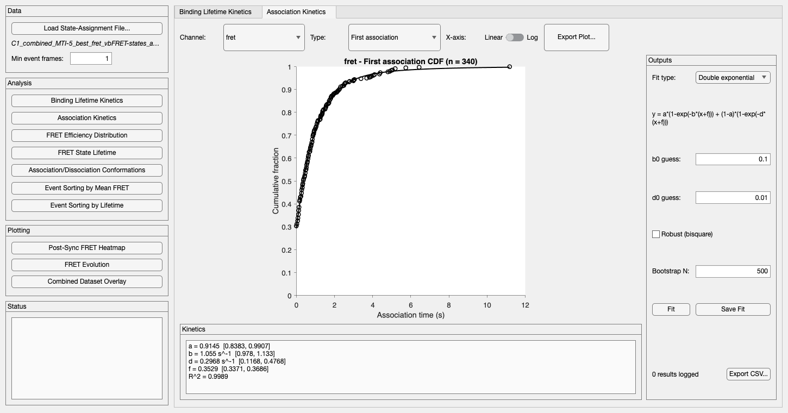

**Purpose.** How fast does association happen? Same exponential-CDF
machinery as Binding Lifetime Kinetics, applied to the *waiting time before*
a binding event rather than the event's own duration.

**How to use it.** Identical controls to Binding Lifetime Kinetics, except
the **Type** dropdown chooses **First association** (time from the start of
data collection until a molecule's first binding event) or
**Reassociation** (time between the end of one binding event and the start
of the next, i.e. re-binding wait times). Fit and Save Fit work exactly as
described in §3.

**What it reports / the math / the bootstrap.** Identical to §3 — same
model, same memoryless/constant-hazard rationale, same fitting approach,
same molecule-level bootstrap reasoning (reassociation wait times in
particular can have several per molecule).

### What's intrinsically different about association?

The fitting machinery is identical to Binding Lifetime Kinetics, but
association and dissociation aren't mirror images of the same physical
process, and a few real differences are worth keeping in mind when
interpreting a fitted rate here.

**Association is bimolecular; dissociation typically isn't.** Binding
requires a free ligand and a free site to encounter each other by diffusion
before they can associate, so the rate this module fits is a
*pseudo-first-order* rate (`kobs = kon × [ligand]`, units s⁻¹) rather than
the intrinsic bimolecular rate constant `kon` itself (units M⁻¹s⁻¹). That
means two Association Kinetics fits from experiments run at different
ligand concentrations aren't directly comparable without accounting for
that difference — recovering `kon` itself requires dividing by the
(approximately constant, pseudo-first-order) free-ligand concentration
used. Dissociation doesn't need a second molecule to show up before it can
happen, so it's usually — though not always — concentration-independent;
see §3 for that caveat (facilitated dissociation) and how to spot it in
your own fits.

**"First association" silently excludes molecules that never bind.** A
molecule that's still waiting when the recording ends contributes no
observation at all: unlike a censored dissociation event, which still
contributes partial information, this molecule contributes none — it's
simply absent from the eCDF. That's a survivorship-type bias: faster-associating molecules are
systematically overrepresented among the events actually observed, which
can bias the fitted rate upward if a meaningful fraction of molecules never
bind within the recording window. This pairs with (but is distinct from)
the frame-censoring discussed in §7 — there, an observed event is present
but its *edge* is ambiguous; here, some fraction of the true population
never produces an observed event at all.

**Why the arbitrary start time is OK.** Unlike dissociation — whose clock
starts at a well-defined physical event, binding onset — "First
association" starts the clock at an arbitrary point: whenever the
recording happened to begin, which has nothing to do with how long that
molecule had already been "waiting" beforehand. This is exactly where the
memoryless property from §3 earns its keep: for a genuinely constant-rate
process, the distribution of "time until the next event, starting from an
arbitrary point" is the same exponential distribution regardless of when
you start watching — so this arbitrary start time doesn't bias the fit, as
long as the memoryless assumption itself holds.

**Output guide.** Same CSV schema as Binding Lifetime Kinetics (§3's
table). The `EventFilter` column carries "First association" or
"Reassociation" instead of the usual All/First/Subsequent labels, so a
single exported file can hold rows for both if you fit each in turn.

## 5. FRET Efficiency Distribution

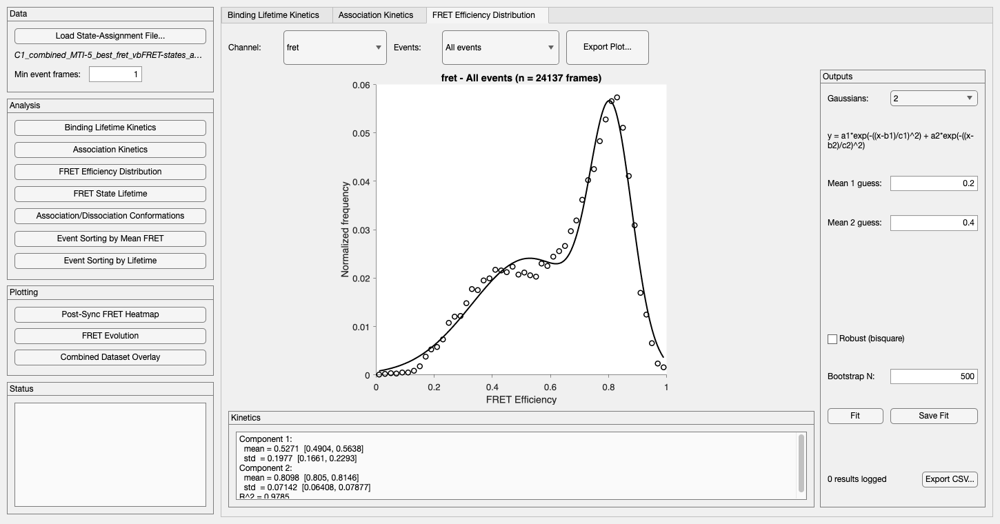

**Purpose.** How many distinct FRET populations (conformations) are present
while a channel is bound, and what's each one's mean efficiency, spread and
population (share of the bound frames)?

**How to use it.** Pick a **Channel** and **Events** filter. Choose the
number of **Gaussians** (1–4); mean-guess fields appear for each component
you've selected (initial guesses matter for multi-component fits — start
from where you visually expect the peaks). Click **Fit**, then **Save Fit**
to log it.

**What it reports.** The histogram (open circles) of pooled FRET values
with the fitted mixture curve (black) overlaid. The Kinetics panel shows
each component's mean, std and population, plus R². The on-plot label gives
each mean with its population in parentheses, e.g. `Mean 1: 0.184 (6%)`;
after Save Fit, the Kinetics panel adds each population's bootstrap CI.

**The math.** Every **frame** during a qualifying binding event contributes
its FRET value — not one value per event, every frame of every event — into
a 50-bin histogram spanning [0, 1], with bin heights normalized to sum to 1
(this makes the shape comparable across datasets with different total
frame counts; it is *not* a probability density). The module then fits a
sum of 1–4 Gaussians to that histogram:

```
y = Σ aᵢ · exp(-((x - bᵢ)/cᵢ)²)     for i = 1..N
```

`bᵢ` is component *i*'s mean; the reported standard deviation is
`cᵢ/√2` (MATLAB's library Gaussian parameterization is not the same as `σ`
directly, so the app converts it for you). The app always reports
components sorted by ascending mean, so "component 1" consistently means the
lowest-FRET population no matter what order the optimizer happened to
converge in.

**Populations.** A component's population is its share of the fitted
curve's total area, the fraction of bound frames it accounts for:

```
Population_i = a_i * c_i / (sum over all components j of a_j * c_j)
```

(each Gaussian's area is `a_i * c_i * sqrt(pi)`; the `sqrt(pi)` cancels). Populations sum to
1, so a 1-Gaussian fit is always 100%. Because frames are pooled, this is a
fraction of *time spent bound* in each FRET state, not a fraction of events
or molecules: a state visited in long events weighs more than one visited in
short events. The area counts each Gaussian's full tails, including any part
that falls outside [0, 1].

A population is a ratio of several fitted coefficients, so it has **no Fit
CI**, only a **Bootstrap CI** (from the same molecule-level resamples, with
the same label-switching matching as the means). A wide population CI
usually means the components overlap enough that the data can't pin down
how frames split between them: treat that split with caution even if the
means look well defined.

**Why NFrames, not just NEvents.** Because the histogram pools every frame
of every event, the number of data points it's built from (`NFrames`)
is much larger than the number of underlying binding events (`NEvents`) —
both are reported so you can judge statistical weight correctly: a
distribution built from a few long events can have a large `NFrames` while
still resting on very few independent molecules, which is exactly why
`NMolecules` (the bootstrap's resampling pool size) is the number that
matters most for judging how trustworthy the Bootstrap CI is.

**Output guide** (`Export CSV...`, one row per Save Fit):

| Column | Meaning |
|---|---|
| `Module`, `Dataset`, `EventFilter`, `Group` | Which module/channel/filter; `Group` is blank here (only meaningful for Event Sorting by Lifetime, §9) |
| `FitType` | e.g. "2-Gaussian Mixture" |
| `NEvents` | True number of underlying binding events |
| `NFrames` | Number of pooled frames the histogram/fit was actually built from |
| `NMolecules` | Distinct molecules contributing (bootstrap resampling pool size) |
| `NBootstrap` | Number of bootstrap resamples that converged successfully |
| `Mean1..Mean4`, `..._FitCI`, `..._BootstrapCI` | Each component's mean and its two CIs (blank/NaN beyond the fitted component count) |
| `Std1..Std4`, `..._FitCI`, `..._BootstrapCI` | Each component's standard deviation and its two CIs |
| `Population1..Population4`, `..._BootstrapCI` | Each component's population as a fraction (0–1) of the fitted area, and its bootstrap CI (no Fit CI; see Populations above) |
| `R2` | Goodness of fit |

## 6. FRET State Lifetime

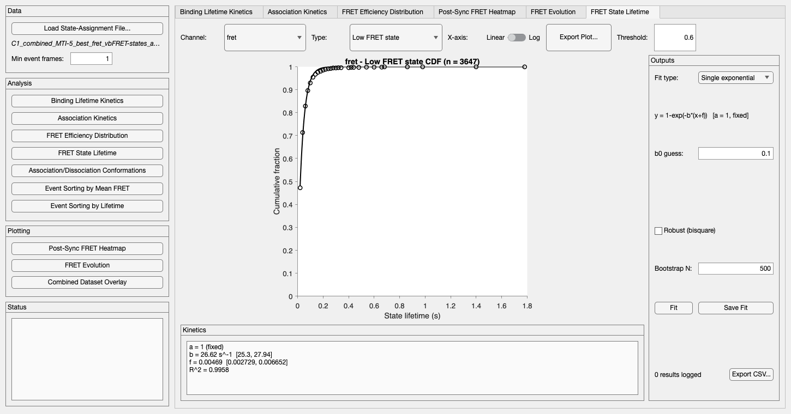

**Purpose.** How long does a molecule stay in the Low- or High-FRET state
once it enters it? Same exponential-CDF fitting as Binding Lifetime
Kinetics, applied to *within-event* state dwell times rather than whole
binding-event durations.

**How to use it.** Pick a **Channel** and **Events** filter, then set the
**FRET Threshold** and choose **Low FRET state** or **High FRET state**
from the Type dropdown. The module classifies every bound frame as Low or
High FRET against the threshold; consecutive same-classification runs
within an event become dwell-time observations for whichever state you
select. Fit and Save Fit work exactly as in §3.

**What it reports / the math / the bootstrap.** Identical fitting
machinery to §3 (single/double exponential fit directly to the eCDF of
dwell times, same memoryless/constant-hazard rationale, same molecule-level
cluster bootstrap reasoning — a molecule can easily contribute several
within-event state dwells).

**Output guide.** Same CSV schema as Binding Lifetime Kinetics (§3's
table). `EventFilter` carries whichever combination of event-type filter
and FRET state ("Low FRET state" / "High FRET state") was selected —
switch the Type dropdown and fit again to log both states into the same
file.

## 7. Association/Dissociation Conformations

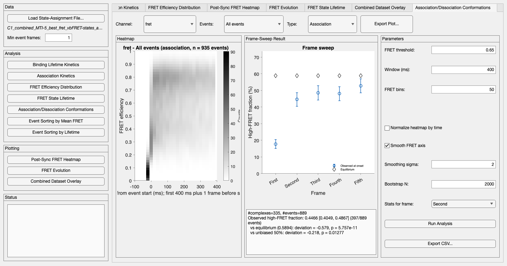

**Purpose.** Does a channel's FRET state (conformation) at a given moment
predict something about the binding event — either the immediate risk of
dissociating (**Dissociation** view) or whether the event *started* in a
particular conformation more or less often than chance/equilibrium
(**Association** view)?

**How to use it.** Pick a **Channel**, **Events** filter, and **Type**
(Association or Dissociation). Set the **FRET threshold** (what counts as
"high FRET"), the display **Window**, **FRET bins** and smoothing for the
heatmap, and **Bootstrap N**, then click **Run Analysis** — unlike this
app's other, live-refreshing modules, this one is gated behind an explicit
button because it runs up to five mixed-effects model fits plus thousands
of bootstrap resamples, which is too slow to re-run on every keystroke.
Once run, the **Stats for frame** dropdown instantly switches which of the
five swept frame positions the text panel describes (no recomputation).

**What it reports.** The **Heatmap** panel shows the full FRET-density
time course around the aligned point (binding onset for Association,
binding offset for Dissociation) — useful for spotting structure the
five-point sweep alone might miss. The **Frame-Sweep Result** panel plots
all five swept frame positions at once, each with a 95% bootstrap CI error
bar; the text box below reports, for whichever frame you select in **Stats
for frame**: the observed odds ratio and its GLMM p-value, the underlying
probabilities/proportions with their bootstrap CIs, and (for Association)
the comparison against both the aggregate equilibrium occupancy and an
unbiased 50/50 reference.

**The math — Dissociation.** For five predictor-frame offsets (the
terminal frame itself, then the 2nd/3rd/4th/5th-to-last frame), the module
pairs every qualifying frame with whether dissociation occurred at the
relevant later frame, then fits a **mixed-effects logistic regression**:

```
dissociate ~ highFRET + (1 | moleculeID) + (1 | eventID)
```

The fixed effect (`highFRET`) asks whether being above the FRET threshold
changes the log-odds of dissociation, *after* accounting for
molecule-to-molecule and event-to-event baseline variability via nested
random intercepts. The reported odds ratio is `exp(β_highFRET)`.

**The math — Association.** The module samples the FRET value at each of
an event's first five frames, then tests the observed fraction classified
"high FRET" against two references via a random-intercept logistic model with a
fixed offset (equivalent to a one-sample test against a target log-odds):
the **aggregate/equilibrium** high-FRET occupancy (pooled across all
frames, using the same hazard-data pool as the Dissociation view's
2nd-to-last frame), and an **unbiased 50%** reference.

### Exposure-time averaging at event edges, and why the module sweeps five frames

Both views have the same underlying measurement problem at the exact frame
position they're aligned to — which is precisely why neither view relies on
a single frame.

**Why a camera frame can't pin down exactly when a transition happened.**
Each recorded frame isn't an instantaneous snapshot — it's a photon count
integrated (averaged) over the entire exposure period (e.g. 20 ms).
Binding and dissociation are effectively instantaneous, continuous-time
events, so a transition can fall at *any* point within that 20 ms window
relative to the frame boundaries, and the recording has no way to say where
within the window it happened. If the true transition falls near the *end*
of an exposure window, nearly the whole window still reflects the *old*
state, and the recorded value stays dominated by it. If it falls near the
*start* of the window, only a sliver of the exposure still reflects the old
state, and the recorded value is instead dominated by the *new* state —
even though the frame still gets classified (and counted) as belonging to
whichever state technically applies for part of it. For the edge frames
this module studies, that has a specific, predictable direction: since the
unbound baseline sits at or near zero FRET, a blended frame's recorded FRET
efficiency is always pulled **artificially lower** than the molecule's true
bound-state value — never higher. That's exactly what confounds
interpreting the FRET state right at binding onset or dissociation: a
genuinely high-FRET conformation can misleadingly read as low-FRET in a
blended edge frame, purely from a timing accident within one exposure
window.

**Dissociation: the terminal frame can be a blend of bound and unbound
signal.** Concretely, for a 20 ms exposure: if a molecule dissociates late
in what would otherwise be its last bound frame — say 15 ms into the
20 ms window — 15 ms (75%) of that exposure still reflects true bound-state
signal, and the frame's reading stays close to the true bound conformation
(reliable). If it instead dissociates early in that same window — say 5 ms
in — only 5 ms (25%) reflects bound-state signal, whereas the remaining
15 ms (75%) is already unbound baseline; the recorded value is pulled toward that
baseline, reading an artificially *lower* FRET efficiency than the
molecule's true bound-state value, even though the frame is (correctly)
counted as the event's last ON frame. Because the exact position of the
true dissociation instant within its exposure window is never recorded,
there's no way to tell, from the data alone, which of these two situations
produced any given "final" frame.

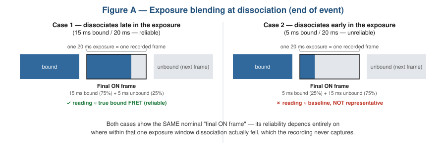

**Association: the same problem, mirrored, at binding onset.** The
identical mechanism applies at the *start* of an event: whichever exposure
window contains the true binding instant is a blend of unbound and bound
signal. If binding happens early in the window — say 1 ms into a 20 ms
exposure — 19 ms (95%) of that window reflects the true bound state, a
reliable reading. If binding happens late — say 15 ms in — only 5 ms (25%)
does, whereas the preceding 15 ms (75%) is still unbound baseline; the
recorded value is pulled toward that baseline, reading an artificially
*lower* FRET efficiency than the molecule's true bound-state value, even
though it's (correctly) the first frame flagged as bound. As with
dissociation, there's no way to tell from the data which situation produced
any given "first" frame.

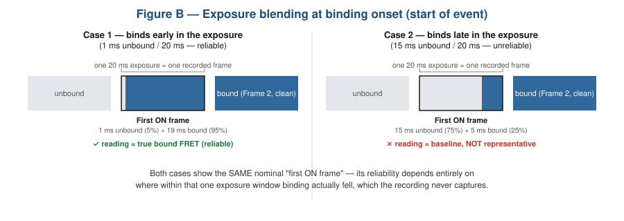

**Why sweep five frames instead of trusting one.** This is exactly why the
module never relies on the very first or very last frame alone. Every frame
*after* the first (or *before* the last) has its *entire* exposure window
falling cleanly within one true state — no blending, no ambiguity — so only
the single frame immediately adjacent to the transition is ever affected.
Sweeping across **five** frame positions in each view (the edge frame plus
four more, stepping inward) and fitting/testing **each one independently**
turns this into something you can directly check rather than something you
have to take on faith: if the reported effect (the odds ratio, or the
onset-composition deviation) is a real kinetic feature, it should show up
consistently from the second position onward; if it's an artifact of
exposure blending at the very edge, it will typically be strong only at the
first/terminal position and disappear from the second position on. This is
also why the app defaults **Stats for frame** to the **second** position
rather than the first/terminal one — a deliberately conservative default
that sidesteps the one frame most likely to be blended, while keeping the
full five-point sweep visible on the plot for you to inspect directly.

**Why mixed-effects, and why bootstrap on top of it.** Frames from the same
molecule or the same event are not independent observations — a molecule
with a long-lived conformational preference will show correlated FRET
readings across many frames. The nested random intercepts absorb that
baseline correlation so the fixed effect reflects the population-level
relationship rather than being distorted by pseudoreplication. Independent
of the GLMM's own (asymptotic) p-values, a molecule-level cluster bootstrap
(same resampling principle as §2) gives a nonparametric CI directly on the
observed proportions, which doesn't rely on the GLMM's assumptions holding.

**Output guide.** This module predates the app's shared per-module result
log and keeps its own independent CSV (`Export CSV...`), with one row per
swept frame position (five per export). **The Stats panel shows the odds
ratio and GLMM p-value, but the CSV doesn't include them** — the CSV
covers only the bootstrap-based observed-proportion summary described
below; read the odds ratio/p-value from the on-screen panel if you need
them recorded elsewhere.

*Dissociation CSV columns:*

| Column | Meaning |
|---|---|
| `Sample`, `Analyzed events`, `Frame Analyzed` | Channel, event filter, and which of the five predictor-frame offsets this row is |
| `Threshold`, `bootstraps` | FRET threshold and bootstrap N used |
| `# complexes`, `# events` | Distinct molecules / events contributing |
| `high FRET (HF) rate`, `HF rate 95% BootstrapCI` | Observed per-frame dissociation probability on high-FRET frames, with bootstrap CI |
| `Low FRET (LF) rate`, `LF rate 95% BootstrapCI` | Same, for low-FRET frames |
| `LF/HF Rate ratio`, `ratio 95% BootstrapCI` | Ratio of the two rates, with bootstrap CI |

*Association CSV columns:*

| Column | Meaning |
|---|---|
| `Sample`, `Analyzed events`, `Frame Analyzed` | Channel, event filter, and which of the five onset-frame positions this row is |
| `Threshold`, `bootstraps` | FRET threshold and bootstrap N used |
| `# complexes`, `# events` | Distinct molecules / events contributing |
| `Start in high FRET` | Count of events classified high-FRET at this onset frame |
| `high FRET ratio`, `high FRET ratio 95% BootstrapCI` | Observed proportion and its bootstrap CI |
| `Aggregate (equilibrium) Occupancy, high FRET` | The equilibrium reference this row's proportion is compared against |

## 8. Event Sorting by Mean FRET

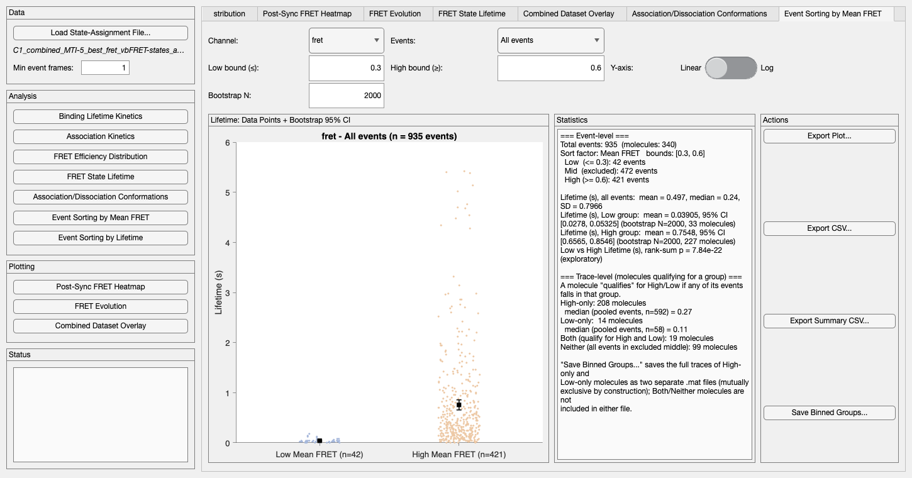

**Purpose.** Splits binding events into Low/High groups by their **mean
FRET efficiency**, then asks: do the two groups differ in how long the
binding lasts?

**How to use it.** Pick a **Channel** and **Events** filter, then set **Low
bound (≤)** and **High bound (≥)** — events with mean FRET at or below the
low bound become the "Low" group, at or above the high bound become "High";
anything in between is excluded as a middle/ambiguous group. Set
**Bootstrap N**. The plot and stats update live as you adjust anything.

**What it reports.** The plot shows each group's individual event lifetimes
as small jittered points (semi-transparent, so overlap reads as density),
with a black square-and-error-bar marker showing that group's bootstrap
mean ± 95% CI on top. The Statistics panel reports, at the event level:
counts per group (and the excluded middle), the pooled lifetime mean/
median/SD, each group's bootstrap mean/CI, and a Wilcoxon rank-sum p-value
comparing the two groups' lifetime distributions (explicitly framed as
exploratory, given the qualitative Low/High split this module makes). At
the trace (molecule) level, it separately reports how many molecules
qualify for only the Low group, only the High group, both, or neither — a
molecule "qualifies" for a group if *any* of its events falls in it.

**The math.** The mean FRET per event is the average of that event's
in-bound FRET values. The reported group mean and CI come from
`pipeline.bootstrapMeanCI` — the same molecule-level cluster bootstrap
principle as everywhere else in this app (resample molecules with
replacement, include all of each drawn molecule's events in that group,
recompute the mean, repeat), which is why a group needs at least 2 distinct
molecules before the module shows a CI at all. The rank-sum test is
nonparametric (no assumption that lifetimes are normally distributed,
which they typically aren't), and the module runs it once on the actual
Low/High event lifetimes directly.

**Output guide.** This module offers two separate exports:

- **Export CSV...** — the full per-event table: `Sample`, `Analyzed
  events`, `Molecule`, `Mean FRET`, `Lifetime (s)`, `Group` (one row per
  event, including the excluded middle group). Useful if you want to
  redo the statistics yourself, or plot the raw data differently.
- **Export Summary CSV...** — one row of summary statistics per export:

| Column | Meaning |
|---|---|
| `Module`, `Dataset`, `EventFilter` | Channel and event filter |
| `LowBound`, `HighBound` | The Low/High mean-FRET thresholds used |
| `NMolecules_Total` | Distinct molecules contributing any event |
| `NEvents_Low`, `NEvents_Mid`, `NEvents_High` | Event counts in each group |
| `NBootstrap` | Bootstrap resamples requested (used for both groups) |
| `Lifetime_Low_Mean`, `Lifetime_Low_BootstrapCI`, `NMolecules_Low` | Low group's bootstrap mean lifetime, its CI, and its resampling pool size |
| `Lifetime_High_Mean`, `Lifetime_High_BootstrapCI`, `NMolecules_High` | Same, for the High group |
| `RankSum_p` | Wilcoxon rank-sum p-value, Low vs. High lifetimes |

**Save Binned Groups...** additionally writes the High-only and Low-only
molecules' full traces out as two separate `.mat` files (in the same format
the app itself can load), for downstream analysis of those specific
molecule subsets.

## 9. Event Sorting by Lifetime

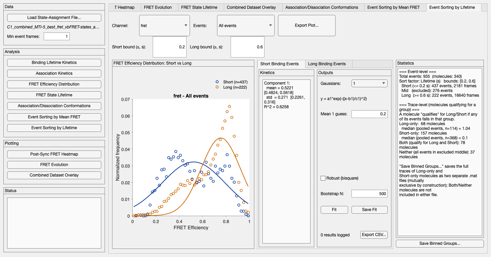

**Purpose.** The mirror image of §8: splits binding events into
Short/Long groups by their **lifetime**, then asks whether the two groups'
**FRET efficiency distributions** differ.

**How to use it.** Pick a **Channel** and **Events** filter, then set
**Short bound (≤)** and **Long bound (≥)** in seconds. The plot shows both
groups' FRET histograms on one shared axes (dark blue = Short, dark orange =
Long) so they're directly comparable. Each group has its own Gaussian-mixture
fit controls in its own sub-tab (**Short Binding Events** / **Long Binding
Events**) — fit each independently; both fitted curves stay visible on the
shared plot regardless of which sub-tab is active.

**What it reports.** Same fitting machinery as FRET Efficiency Distribution
(§5): every frame of every qualifying event in a group contributes to that
group's normalized 50-bin histogram, fit with a 1–4 component Gaussian
mixture. The Statistics panel reports event and frame counts per group,
plus the same High-only/Low-only/Both/Neither trace-level breakdown as §8
(here, Short-only/Long-only/Both/Neither).

**The math and the bootstrap.** Identical to §5 in every respect — see that
section for the model, the frame-pooling rationale, and the label-switching
handling for multi-component fits.

**Why Short and Long share one CSV.** Unlike every other module, Short's
and Long's Save Fit both log into the **same** result table (distinguished
by the `Group` column) rather than two separate files — since they're the
same underlying comparison split into two groups, keeping both in one file
makes the intended Short-vs-Long comparison easy to do directly from the
exported CSV.

**Output guide** (`Export CSV...`, available from either sub-tab — both
write to the same table):

| Column | Meaning |
|---|---|
| `Module`, `Dataset`, `EventFilter` | Channel and event filter |
| `Group` | `"Short"` or `"Long"` — which group this row's fit is for |
| `FitType` | e.g. "1-Gaussian Mixture" |
| `NEvents` | True number of binding events in this group |
| `NFrames` | Pooled frames the histogram/fit was built from |
| `NMolecules`, `NBootstrap` | Bootstrap resampling pool size and resample count |
| `Mean1..Mean4`, `Std1..Std4` (+ `_FitCI`, `_BootstrapCI` each) | Same as §5 |
| `Population1..Population4` (+ `_BootstrapCI`) | Same as §5 |
| `R2` | Goodness of fit |

**Save Binned Groups...** works exactly as in §8, but based on the
Short/Long lifetime split instead of the mean-FRET split.

## 10. Donor-Acceptor Correlation

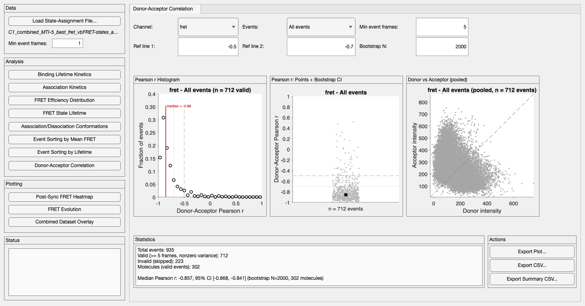

**Purpose.** Is the raw donor/acceptor intensity behavior consistent with
genuine FRET? Computes the within-event Pearson correlation between raw
donor and acceptor intensities — energy transfer moves excitation from
donor to acceptor, so a real FRET pair's intensities should anti-correlate
(donor drops as acceptor rises, and vice versa) whenever the underlying
conformation fluctuates. A lack of anti-correlation for a meaningful
fraction of events can flag bleed-through, non-specific binding, or other
artifacts worth investigating before trusting the FRET values those events
produced.

**How to use it.** Assumes 2-color data: channel 1 is treated as the
donor's raw intensity and channel 2 as the acceptor's, positionally —
there's no separate Donor/Acceptor selector. Pick a **Channel** (which
channel's events define the bound/unbound boundaries — typically the
calculated FRET channel) and an **Events** filter, then set **Min event
frames** (events shorter than this are excluded as too short to correlate
meaningfully) and the two **Ref line** fields (default -0.5 / -0.7, shown
as dashed/dotted reference lines on the plots — adjust to whatever
anti-correlation threshold is meaningful for your system). Everything
recomputes live.

**What it reports.** Three plots, always shown together:

- **Pearson r Histogram** — probability-normalized histogram of each valid
  event's Donor-Acceptor Pearson r, with the median r marked and the two
  reference lines overlaid.
- **Pearson r: Points + Bootstrap CI** — every valid event's r as a
  jittered point, with a molecule-level cluster bootstrap median ± 95% CI
  marker on top (the same points+CI *visual* convention as Event Sorting
  by Mean FRET, §8 — see §2 for why resampling is done by molecule — but
  summarizing the median here rather than the mean; see "The math" below).
- **Donor vs Acceptor (pooled)** — every valid frame of every valid event,
  donor intensity vs. acceptor intensity, with a corner-to-corner diagonal
  reference.

The Statistics panel below reports total/valid/invalid event counts, the
number of distinct molecules contributing valid events, and the bootstrap
median r ± CI.

**The math.** For each event, donor and acceptor raw intensity traces are
pulled over its bound duration (onFrame:offFrame) and compared directly via
Pearson's r — no smoothing, no detrending. An event is excluded (`Valid =
false` in the per-event export) if it has fewer than **Min event frames**
frames, or if either trace has zero variance over the event (a degenerate
case Pearson's r can't be computed for). The summary statistic bootstrapped
here is the **median**, not the mean like this app's other points+CI
modules (e.g. Event Sorting by Mean FRET, §8) — Pearson r is bounded to
[-1, 1] and often skewed for real data, so median is the more robust point
estimate (`pipeline.bootstrapMedianCI`, the same molecule-level cluster
resampling as `pipeline.bootstrapMeanCI` elsewhere, just summarizing each
resample with `median()` instead of `mean()`).

**Output guide.** This module offers two separate exports, matching Event
Sorting by Mean FRET's convention (§8) rather than the shared per-module
result log — there's no curve fit here to log via Save Fit:

- **Export CSV...** — the full per-event table: `Sample`, `Analyzed
  events`, `Molecule`, `Event length (frames)`, `Donor-Acceptor Pearson r`,
  `Valid` (one row per event, including invalid ones — `Donor-Acceptor
  Pearson r` is blank/NaN for those). Useful if you want to redo the
  statistics yourself or plot the raw per-event values differently.
- **Export Summary CSV...** — one row of summary statistics per export:

| Column | Meaning |
|---|---|
| `Module`, `Dataset`, `EventFilter` | Channel and event filter |
| `MinEventFrames` | The minimum-frames cutoff used |
| `ReferenceLine1`, `ReferenceLine2` | The two reference-line r values used |
| `NEvents`, `NValid`, `NInvalid` | Event counts |
| `NMolecules_Valid` | Distinct molecules contributing valid events (bootstrap resampling pool size) |
| `Median_PearsonR`, `Median_PearsonR_BootstrapCI` | Bootstrap median r and its CI |
| `NBootstrap` | Bootstrap resamples requested |

**Export Plot...** writes all three plots as one matched set
(`_histogram`/`_pointsCI`/`_donorVsAcceptor` suffixes appended to whatever
base name you choose), the same one-button-for-multiple-plots convention as
Association/Dissociation Conformations (§7).

## 11. Post-Sync FRET Heatmap

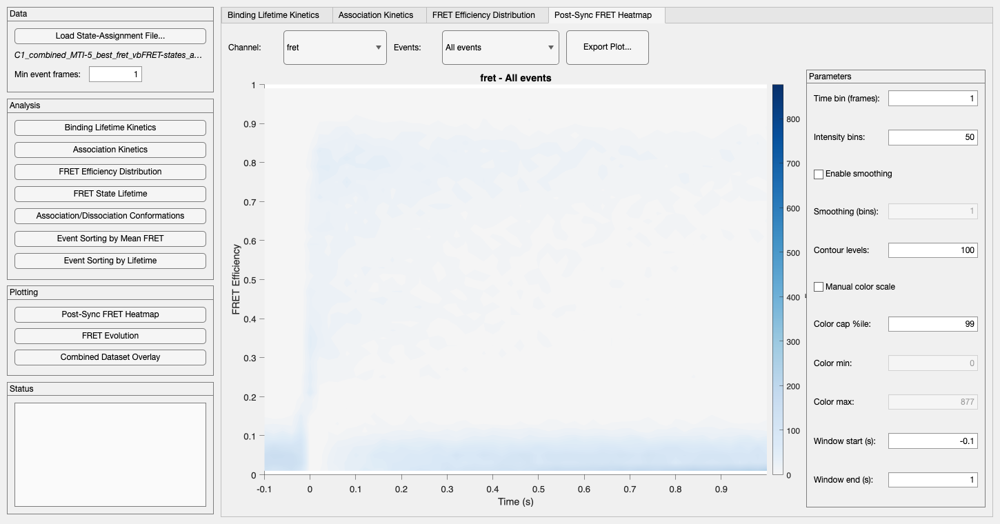

**Purpose.** A purely visual module (no fitting, no CSV export): shows how
a channel's FRET efficiency evolves over time across an entire ensemble of
events, aligned to each event's own binding onset.

**How to use it.** Pick a **Channel** and **Events** filter. The module
pulls every included event's *entire* trace (not just its bound portion)
and time-aligns it so `t = 0` is that event's onset frame, bins each
aligned time slice into a FRET-efficiency histogram, and renders the
resulting time × FRET-efficiency matrix as a filled contour plot. The
**Parameters** panel splits into three responsiveness tiers: **Time bin**,
**Intensity bins**, Channel, and Events fully re-extract and re-bin the
data; **Smoothing** toggles/retunes a 2D Gaussian smoothing pass on the
already-binned matrix without re-binning; and **Contour levels**, color
scale, and the time **window** are pure display parameters that replot
instantly with no recomputation at all.

**The math.** Smoothing (`pipeline.smoothHeatmap2D`) is a separable 2D
Gaussian convolution with edge-replicated padding (matching what
`imgaussfilt` would do, without requiring the Image Processing Toolbox) —
replicated rather than zero-padded edges matter here because real FRET mass
often sits close to 0 or 1, and zero-padding would artificially dim the
heatmap near those edges.

## 12. FRET Evolution

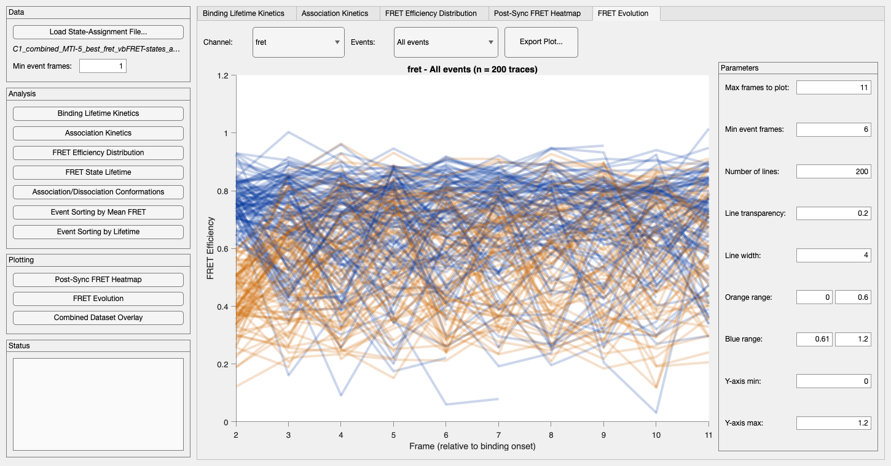

**Purpose.** Another purely visual module: plots individual per-event FRET
trajectories right after binding onset, as semi-transparent overlaid lines
so the ensemble's density and spread are visible at a glance.

**How to use it.** Pick a **Channel** and **Events** filter. The module
plots each qualifying event's bound-duration segment starting from its
second frame — skipping the first and last frames of an event as likely
transition artifacts — out to **Max frames to plot**, capped at
**Number of lines** total traces. It colors each trace by its FRET value
at the second frame, falling in the **Orange range** or **Blue range** you
set (it skips events outside both ranges entirely), with **Line
transparency** and **Line width** controlling how the overlay reads.

## 13. Combined Dataset Overlay

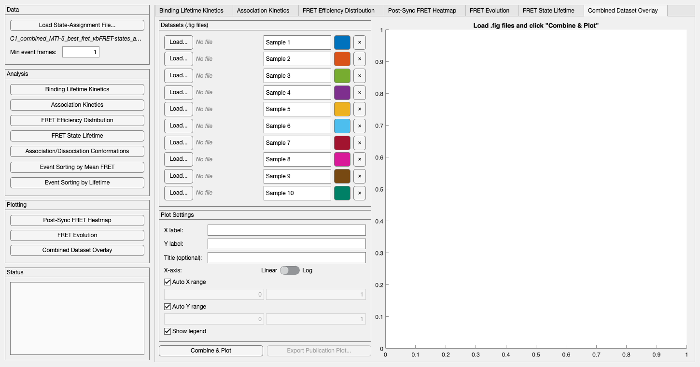

**Purpose.** The only module that doesn't need a loaded state-assignment
file at all: combines multiple previously-exported `.fig` plots (from this
app's own **Export Plot...** buttons, or any `.fig` following the same
open-circle-markers-for-data / plain-line-for-fit convention) into one
publication-ready comparison figure — useful for putting the same kind of
plot from different samples, conditions, or analysis sessions side by side.

**How to use it.** For each of up to 10 rows, click **Load...** to pick a
`.fig` file, give it a sample name, and pick a display color. Click
**Combine & Plot** to read every configured row and overlay them (this is a
deliberate button rather than a live update, since reading 10 files is
nontrivial I/O you don't want repeated on every keystroke) — it recolors
each sample's data markers and fit line to its assigned color, and
standardizes everything else about their appearance so the combined figure
looks like one consistent plot rather than a patchwork of each source
file's original style. The module auto-fills axis labels from the first
loaded file, though you can edit them; axis ranges, log/linear scale, and
the legend are all live against the already-combined data, so changing
them needs no file re-read.

**Exporting.** **Export Publication Plot...** applies this module's own
fixed publication styling (a constant-size axes box, thin dark-gray axis
lines, outward ticks, transparent background) — a different, dedicated
style from the generic per-module `pipeline.exportPlot` used everywhere
else in the app, since a combined-overlay figure has different presentation
needs than a single module's own plot.

## 14. Summary Figure

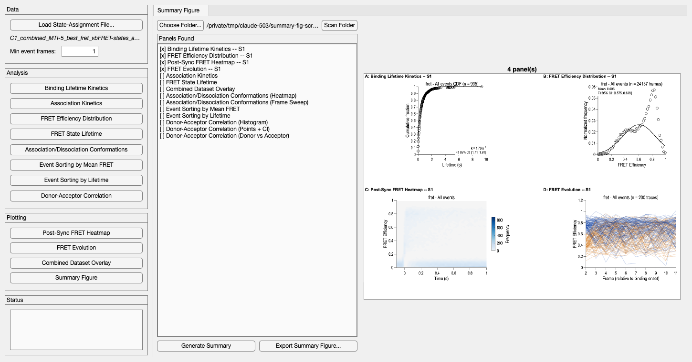

**Purpose.** A fast way to see everything at once: automatically finds
every module's previously-exported plots in a chosen folder and assembles
them into one multi-panel page, so you don't have to open a dozen separate
exported images — or revisit every module one at a time — just to sanity-
check a dataset.

**How to use it.** Like Combined Dataset Overlay (§13), this module doesn't
need a loaded state-assignment file — it works entirely from `.png` files
this app already exported, via any module's own **Export Plot...** button.
Click **Choose Folder...** to pick the directory holding those exports,
then **Scan Folder** — the Panels Found list shows, for every plot this app
can produce, whether a matching file was found in that folder (`[x]`) or
not (`[ ]`). Click **Generate Summary** to build the composite and preview
it, then **Export Summary Figure...** to save it as both `.png` and `.eps`.

**What it reports.** Every module's exported `.png` is tagged,
automatically, with a fixed filename suffix identifying which module (and,
for a module that exports more than one distinct plot — Association/
Dissociation Conformations' heatmap + frame-sweep, or Donor-Acceptor
Correlation's three plots — which specific one) produced it. You never
have to name files a particular way for this to work: whatever base name
you typed when exporting, the suffix is appended automatically. **Every
matching file in the folder becomes its own panel** — not just the most
recent one. If you've exported the same plot type more than once with
genuinely different content (a different channel, a different Events
filter, both directions of Association/Dissociation Conformations...), all
of those exports show up as separate, individually labeled panels (`A`,
`B`, `C`... in the order scanned), rather than only the newest surviving.
A plot type never exported into that folder is simply skipped — panel
letters stay contiguous across however many panels were actually found.

Panel size is fixed regardless of how many panels there are; the page
grows taller (and the grid gains columns, up to four) to fit more of them,
rather than shrinking panels down to squeeze onto a fixed page. This is
deliberately built for scrolling through on a screen, not a single printed
sheet — a folder with a lot of exports in it produces a correspondingly
large page, which is fine.

### Why raster, not vector

Each panel is placed as the exact pixels of the `.png` this app already
exported — not reconstructed from the underlying plot data. An earlier
version of this module instead rebuilt each panel from its `.fig` file's
own graphics objects, so the composite's own `.eps` export could stay true
vector throughout. That reconstruction couldn't perfectly reproduce every
formatting detail this app's individual export was carefully tuned for
(font scaling, line widths, alpha-blended semi-transparent traces,
colorbar sizing...), and the composite visibly drifted from what the
individual export actually looked like — defeating the point of a fast,
trustworthy overview. Placing the `.png` as-is guarantees a summary panel
looks identical to its individual export, at the cost of the composite's
own `.eps` embedding a raster image per panel rather than re-vectorizing
it.

**Output guide.** There's no CSV here — Summary Figure only ever reads
other modules' already-exported `.png` files and writes a composite image.
**Export Summary Figure...** saves that composite as both `.png` (600 DPI)
and `.eps`.
