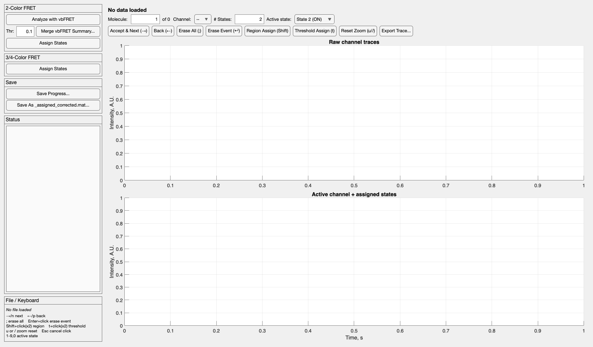
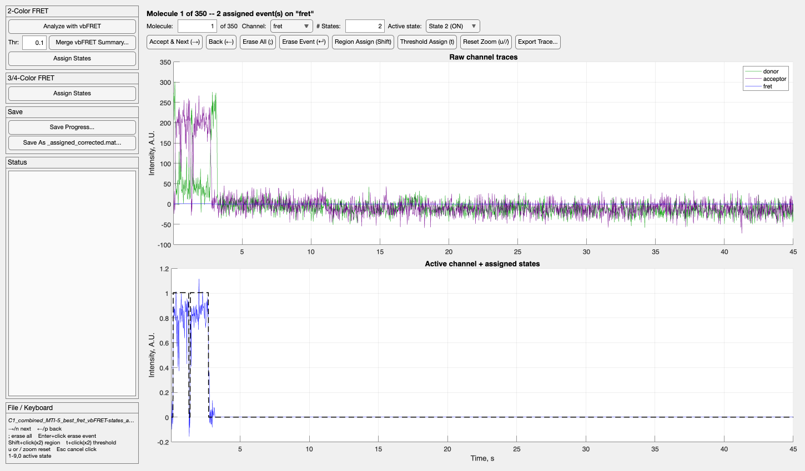

# Assign States — User Guide

This guide covers the Assign States app: where it sits in the
overall analysis pipeline, every panel and control, the data formats it
reads and writes, and how to troubleshoot common failure points.

## 1. Where this app fits

Assign States is the **upstream** half of a two-app pipeline. It produces
the `*_assigned_corrected.mat` file that the separate **Analysis Pipeline**
app uses for kinetics, FRET-distribution, and conformational analyses.
Everything downstream of this app assumes that file already exists and is
correct, so mistakes made here (a missed event, a channel assigned by
mistake) propagate into every analysis.

The full path from raw data to that file, depending on your experiment:

**2-color FRET (vbFRET-assisted):**

1. **Analyze with vbFRET** (external Gonzalez lab tool, launched from this app) — idealizes
   each molecule's FRET trace into a small number of states. Use as normal: typically 3 states, 20 iterations.
2. **Merge vbFRET Summary** (this app) — thresholds vbFRET's idealized trace
   into ON/OFF and writes it into the same `ttotal`/`states` format
   everything else in this pipeline uses.
3. **Assign States** (this app) — you visually review every molecule and
   correct whatever vbFRET got wrong (missed a real event, split one event
   into two, called noise an event, etc.).

**3- or 4-color (no vbFRET step):**

1. **Assign States** (this app) — you import the raw `.traces` file and
   assign every channel's states by hand from the start; there's no
   automatic pre-assignment to correct.

Both paths converge on the same output format and the same review screen —
see §4.

## 2. Running the app

**Requirements.** MATLAB (developed against R2023b). No additional
toolboxes are required by this app itself, but:

- **Launch with vbFRET** and **importing a raw `.traces` file** both call
  external functions (`vbFRET`, `loadTraces`) that come from vbFRET/SPARTAN,
  not this app — those need to be on your MATLAB path separately (see §7 if
  you get a "not found" error).
- The folder containing `AssignStatesApp.m` and the `+pipeline` package
  folder also needs to be on the MATLAB path.

**To launch:** in the Command Window, type `AssignStatesApp` and press
Enter. To keep a handle to the running app (for scripting, or inspecting
`app.Data` from the Command Window), use `app = AssignStatesApp();`
instead.

## 3. Data format

Every file this app reads or writes (aside from raw `.traces` files and
vbFRET's own Analysis Summary) shares one format — the same one the
Analysis Pipeline app expects:

- **`ttotal`** — `[frames × (1 + nChPerMol·molecules)]`. Column 1 is the
  time axis in seconds. Each molecule then occupies `nChPerMol` consecutive
  columns, one per channel, in the same order every molecule.
- **`states`** — the same shape as `ttotal`. Each channel's column holds
  its discrete state assignment per frame: `0` always means OFF/unassigned;
  any channel that has never been touched is all-zero.
- **`channelNames`** — a cell array naming the `nChPerMol` channels, in
  column order (e.g. `{'donor','acceptor','fret'}`).
- **`nChPerMol`** — channels per molecule (an integer scalar).

This app never assumes a fixed number or order of channels — everything is
computed from `nChPerMol` and matched by name (e.g. finding "the fret
channel" is a case-insensitive name search, not "always column 3"), so the
same app handles 2-, 3-, and 4-color data without modification.

**Older files (backwards compatibility).** `.mat` files from before
multi-color support contain only `ttotal` and `states`. If a file has those
two variables and *neither* `channelNames` nor `nChPerMol`, the app treats
it as 2-color data with three channels per molecule — `donor`, `acceptor`,
`fret` — and says so in the status log. It first checks that `ttotal` and
`states` are the same size and that the number of data columns (all columns
after the time column) is a multiple of 3; if not, it shows an error
instead of guessing. Saving such a file (Save Progress or Save As) writes
the full four-variable format, so it is upgraded from then on. The batch
script `RecalcFretAndResetStates.m` applies the same rule to
`*_progress.mat` files. A file with only *one* of `channelNames` /
`nChPerMol` is not treated as old-format.

**Where each stage's file conventionally comes from**, following this
lab's naming pattern:

| File | Produced by |
|---|---|
| `..._best_fret.traces` | SPARTAN (upstream of this app entirely) |
| `..._vbFRET-states.mat` | vbFRET's own "Save Analysis Summary" |
| `..._vbFRET-states_assigned.mat` | this app's Merge vbFRET Summary (auto-saved) |
| `..._assigned_corrected.mat` | this app's Save As, after you've reviewed every molecule |

None of these names are enforced by the app, but please continue to follow this convention so each data directory self documents.

## 4. The three panels

### 2-Color FRET

- **Analyze with vbFRET** launches the external vbFRET GUI (assuming it's
  on your MATLAB path) and logs a reminder of the manual steps: load your
  `.traces` file in vbFRET, set max states to 3, run at least 20
  iterations, then **File → Save Data → Save Analysis Summary** (name it to
  end in `_vbFRET-states`). This app does not control vbFRET once it's
  open — it's a separate window.
- **Merge vbFRET Summary...** needs two files: the ttotal source (a raw
  `.traces` file, imported on the spot, or an already-converted `.mat`) and
  vbFRET's Analysis Summary (the `path` variable it saves — a per-molecule
  idealized FRET trace). If no data is loaded in the app yet, a dialog says
  so and you're prompted for the ttotal source first, then the vbFRET
  summary. **Thr** (default 0.1) is the FRET threshold: idealized frames
  above it become ON, at or below become OFF. The merged result is
  **automatically saved** next to the vbFRET summary file, named by
  appending `_assigned` to that file's own name — no separate save step
  needed for this stage.
- **Assign States** — see §5 (shared with the panel below).

### 3/4-Color FRET

- **Assign States** — the only control in this panel. Picks a raw `.traces`
  file directly (no vbFRET step) and goes straight to the review screen
  with every channel's states at zero, ready for manual assignment from
  scratch.

Both panels' **Assign States** buttons run the exact same code — the
difference is only which file you'd naturally pick there (a fresh
`.traces` file for 3/4-color, or an already-merged `.mat` for 2-color).

### Save

Independent of which panel you used to get here:

- **Save Progress...** writes the current `ttotal`/`states`/`channelNames`/
  `nChPerMol` plus which molecule you were on, so reopening that file (via
  either panel's Assign States button) resumes exactly there instead of
  starting over at molecule 1.
- **Save As _assigned_corrected.mat...** writes the same data without the
  resume marker — this is the file the Analysis Pipeline app expects.

Neither button requires you to have finished reviewing every molecule —
save and resume as often as you like.

## 5. Reviewing and correcting states

The top plot shows every channel's raw fluorescence trace for the current molecule
(donor green, acceptor dark purple, fret bright blue, by name — any other
channel name falls back to a default color cycle). The bottom plot shows
the **active channel's** raw trace plus its assigned states, scaled to
overlay for easy visual comparison.

### Navigation

Right arrow / `n` accepts the current molecule's states as-is and moves to
the next; left arrow / `p` goes back. Both act immediately — no confirmation
dialog needed. The **Molecule** field jumps directly to a given number.

### Channels, states, and the active state

- **Channel** picks which channel's `states` column you're editing. It
  defaults to whichever channel's name contains "fret" (case-insensitive),
  since that's the channel actually assigned in the standard 2-color
  workflow; switch it manually for a 3/4-color experiment where more than
  one channel needs assignment.
- **# States** sets how many discrete levels exist (1–10). Most analyses
  only need 2 (OFF/ON), which is the default.
- **Active state** is which level clicking or a digit key will write.
  States are numbered starting at **1** (State 1 = OFF, State 2 = ON, ...)
  specifically so the digit keys line up naturally: pressing `1` selects
  state 1, `2` selects state 2, and so on through `9`, with `0` selecting a
  10th state — the same order as the keyboard's own number row. This is a
  display/selection convention only: what's actually written into the
  `states` matrix is still 0-indexed (OFF is still stored as `0`), matching
  vbFRET's merge output and what the Analysis Pipeline app expects — so a
  file this app saves is byte-for-byte compatible whether or not you ever
  touch # States. In general, State *k* is always recorded as `k-1` (e.g.
  State 3 is stored as `2`, State 10 as `9`).

### The four ways to change states

All four act on the **active channel** of the **current molecule** only.

- **Erase All** (`;`) — zeroes the entire channel for this molecule. Use
  this when vbFRET (or a previous pass) got the whole trace wrong and
  you'd rather start over than pick out individual mistakes.
- **Erase Event** (`Enter`, then click) — click on or near one specific
  assigned run of frames, and just that contiguous run is zeroed, leaving
  every other event on the trace untouched. This is the one to reach for
  when vbFRET mostly got it right but flagged one spurious blip.
- **Region Assign** (`Shift`, then click twice) — the two click positions'
  *x* values become the new region's boundaries; every frame in between is
  set to the active state, regardless of what it was before.
- **Threshold Assign** (`t`, then click twice) — the two clicks' *x* values
  set a region exactly as above, but only frames **within** that region
  **and above** the second click's *y* value (read against the active
  channel's raw trace) are set to the active state. Use this when an event
  is genuinely present but noisy, and you want the assignment to track the
  signal rather than a hand-drawn box.

Any armed click-action (Region/Threshold Assign, Erase Event) can be
cancelled with `Esc` before you finish clicking it. Navigating to a
different molecule while one is armed also cancels it silently, so a
half-finished click sequence never accidentally lands on the wrong
molecule.

### Zooming

Drag a rectangle anywhere on either plot to zoom into it — this is always
available, with no separate "zoom mode" to turn on, and armed click-actions
automatically take over the same drag gesture for their own clicks while
they're active (so dragging to define a Region Assign boundary doesn't
also zoom). **Reset Zoom** (`u` or `/`, or its button) restores the full
time range and auto-fits both plots' y-axes.

### Exporting a trace

**Export Trace...** saves the current molecule's two plots (raw channel
traces on top, active channel plus assigned states below) as a figure you
can use in a talk or paper. A save dialog asks for a file name and has a
file-type dropdown with three options:

- **`.fig`** — a standard MATLAB figure that reopens with full editing
  support (Property Editor, Edit Plot).
- **`.eps`** — vector graphics, for Illustrator or journal figures.
- **`.png`** — a 300 DPI image, for slides and quick sharing.

The default name is `<data file>_mol<N>`, with the molecule number filled
in. One format is saved per click, so export again to get another. The
export always covers the **full time range**, regardless of how far you've
zoomed in the app, and it doesn't change the zoom on screen.

## 6. A worked example (2-color)

1. Click **Analyze with vbFRET** in the **2-Color FRET** panel.
2. In vbFRET: load `sample_best_fret.traces`, set max states to 3, run 20+
   iterations, then File → Save Data → Save Analysis Summary as
   `sample_vbFRET-states.mat`.
3. Back in this app, click **Merge vbFRET Summary...**. Since nothing is
   loaded yet, you're prompted for the ttotal source first — pick
   `sample_best_fret.traces` directly (it gets imported on the spot) — then
   for the vbFRET summary — pick `sample_vbFRET-states.mat`. The merge
   auto-saves `sample_vbFRET-states_assigned.mat` next to it.
4. Click **Assign States** (either panel) and open that same
   `sample_vbFRET-states_assigned.mat` to start reviewing molecule 1.
5. Step through with → / `n`, fixing anything vbFRET got wrong with Erase
   Event, Region Assign, or Threshold Assign as needed.
6. Periodically click **Save Progress...** so a crash or accidental close
   doesn't lose completed work.
7. Once every molecule's been reviewed, click **Save As
   _assigned_corrected.mat...** — this is the file to open in the Analysis
   Pipeline app.

## 7. Troubleshooting

**"vbFRET was not found on the MATLAB path."** Add vbFRET's folder (e.g.
`ebfret-gui`) via **Home → Set Path...**, then try again. This app doesn't
bundle vbFRET — it only launches whatever `vbFRET` command your own MATLAB
installation already provides.

**Import fails with an error about `loadTraces`.** Same cause as above, for
SPARTAN instead of vbFRET — its `Traces` folder needs to be on your path.

**"File does not contain a 'path' variable" when merging.** You picked the
wrong file for the vbFRET summary step — it needs to be the file saved via
vbFRET's **File → Save Data → Save Analysis Summary**, which contains a
variable literally named `path`. A raw `.traces` file or a `ttotal`-format
`.mat` won't have this.

**"No channel name containing 'fret' found" when merging.** The ttotal
source you loaded has no channel named anything containing "fret" (check
`channelNames`) — vbFRET's summary is a single idealized FRET trace per
molecule and needs a matching FRET channel to merge into. If your channel
is named something else (e.g. just "ratio"), rename it in the source file,
or merge by hand.

**"vbFRET path has N molecule(s) but ttotal implies M."** The vbFRET
summary and the ttotal source don't agree on how many molecules there
are — almost always because they came from two different `.traces` files
(e.g. you ran vbFRET on the full dataset but are merging against a filtered
subset, or vice versa). Re-check you picked the matching pair.

**"File is missing required variable(s)"** when opening a `.mat` via
Assign States. That file doesn't have all four of `states`, `ttotal`,
`channelNames`, `nChPerMol` (a file with just `ttotal` and `states` is
accepted as old-format 2-color data, see section 3) — it's from some other stage of the pipeline
(e.g. a raw SPARTAN `.traces` file renamed to `.mat`, which this app
would only recognize correctly with its real `.traces`/`.rawtraces`
extension) or a corrupted/partial save.

**A drag on the plot doesn't zoom.** Check whether a click-action is
currently armed (Region Assign, Threshold Assign, or Erase Event, from a
key or button press) — while one is, the same drag gesture is dedicated to
collecting that action's clicks instead of zooming. Press `Esc` to cancel
it, and dragging goes back to zooming immediately.

## 8. For scripting: the `+pipeline` functions

Every non-interactive piece of this app's logic is a standalone, testable
function in `+pipeline/`, independent of the GUI — useful if you want to
batch-process files from a script rather than click through the app:

| Function | Purpose |
|---|---|
| `pipeline.importTraces(filename)` | `.traces` → `ttotal`/`states`/`channelNames`/`nChPerMol` |
| `pipeline.mergeVbFretSummary(...)` | Threshold + merge a vbFRET `path` into `states` |
| `pipeline.getMolCols(molIdx, nChPerMol)` | Column indices for given molecule(s) |
| `pipeline.applyLegacyDefaults(d)` | Fills in 2-color `channelNames`/`nChPerMol` for old `ttotal`/`states`-only files |
| `pipeline.findChannelIndex(channelNames, pattern)` | Case-insensitive channel lookup by name |
| `pipeline.countBouts(vec)` | Number of contiguous assigned-state runs in a column |
| `pipeline.regionToFrames(x1, x2, t)` | Convert two time-axis positions to frame indices |

`AssignStatesApp`'s own data-handling methods (`loadDataStruct`,
`pickAndLoadDataFile`, `activeChannelCol`, and the navigation/assignment
methods) are also public on the app object for the same reason — e.g.
`app.Data` after loading a file gives you the same struct fields described
in §3 directly from the Command Window.
